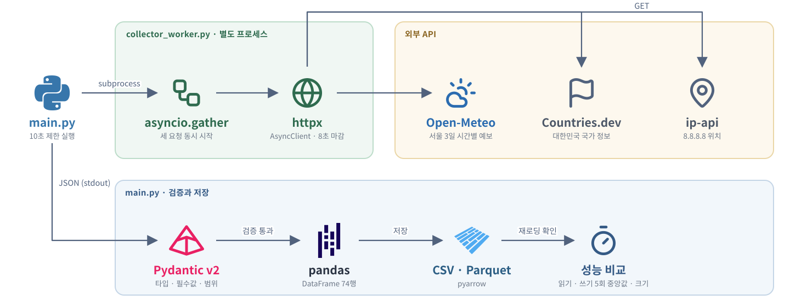

# 비동기 데이터 수집 미니 파이프라인

SKALA 데이터 분석 · AIOps 과정 Day 1 종합 실습입니다. 서로 다른 세 공개 API에서 날씨 · 국가 · IP 위치 데이터를 동시에 받아 Pydantic으로 검증하고, CSV와 Parquet로 저장한 뒤 다시 읽어 데이터가 그대로인지 확인합니다. 두 형식의 읽기 · 쓰기 시간과 파일 크기도 비교합니다.

## 전체 아키텍처

  

| 파일 | 역할 |
|------|------|
| `main.py` | 수집 프로세스 실행 → 검증 → 저장 · 비교 → 결과 출력 |
| `collector_worker.py` | 별도 프로세스에서 `collect_all()`을 실행하고 결과를 JSON으로 stdout에 출력 |
| `collectors.py` | API 주소, 동시 요청, 응답을 행 단위 dict로 바꾸는 함수 |
| `models.py` | `WeatherRecord`, `CountryInfo`, `IpLocation` Pydantic 모델 |
| `storage.py` | CSV · Parquet 저장, 5회 반복 측정, 재로딩 무결성 확인 |
| `test_pipeline.py` | 검증 모델의 정상 · 범위 초과 · 문자열 숫자 입력 테스트, 응답 변환 함수의 빈 배열 · 길이 불일치 · ip-api 실패 응답 테스트 |

## 각 기술 설명

### asyncio · httpx

`collectors.py`의 `collect_all()`이 하나의 `httpx.AsyncClient`로 세 요청을 만들고 `asyncio.gather()`로 동시에 기다립니다. 각 요청은 `asyncio.wait_for`로 8초 마감을 걸어, HTTP 클라이언트 타임아웃만으로 막기 어려운 DNS 지연도 끊습니다.

| API | 요청 | 결과 |
|-----|------|------|
| Open-Meteo | 서울 좌표, `temperature_2m` · `precipitation_probability`, 3일 | 시간별 72행 |
| Countries.dev | `/alpha/KOR` | 국가명 · 수도 · 인구 등 1행 |
| ip-api | `8.8.8.8` | 국가 · 도시 · 위도 · 경도 1행 |

### subprocess — 수집 프로세스 분리

`main.py`는 수집을 `collector_worker.py` 하위 프로세스로 실행하고 10초 안에 끝나지 않으면 종료합니다. SSL · DNS 초기화가 멈춰도 메인 프로그램이 같이 멈추지 않게 하기 위한 구조입니다.

### Pydantic v2

`model_validate`로 API별 필수 필드와 값 범위를 검사합니다. 기온은 -90~65℃, 강수 확률은 0~100, 국가 코드는 대문자 3자리, 인구는 양수, 위도 · 경도는 지리 범위 안이어야 하며, `field_validator(mode="before")`로 숫자 자리에 문자열이 들어오는 경우를 범위 검사 전에 걸러 냅니다. 하나라도 실패하면 어느 API의 어느 필드인지 메시지로 알려 주고 저장하지 않습니다.

### pandas · PyArrow (CSV · Parquet)

검증된 74행을 하나의 DataFrame으로 합쳐 `to_csv`와 `to_parquet`로 저장합니다(Parquet 엔진은 requirements의 pyarrow). `storage.py`가 쓰기 · 읽기를 각각 5회 반복한 중앙값과 파일 크기를 비교하고, 두 파일을 다시 읽어 행 수와 컬럼이 저장 전과 같은지 확인합니다.

### pytest · Ruff

`test_pipeline.py`가 날씨 모델이 정상 값은 받고, 범위를 넘는 강수 확률과 문자열 기온은 거부하는지 검사합니다. 응답 변환 함수가 빈 배열 · 길이가 다른 배열 · ip-api 실패 응답을 거부하는지도 검사합니다. Ruff는 정적 검사에 씁니다.
